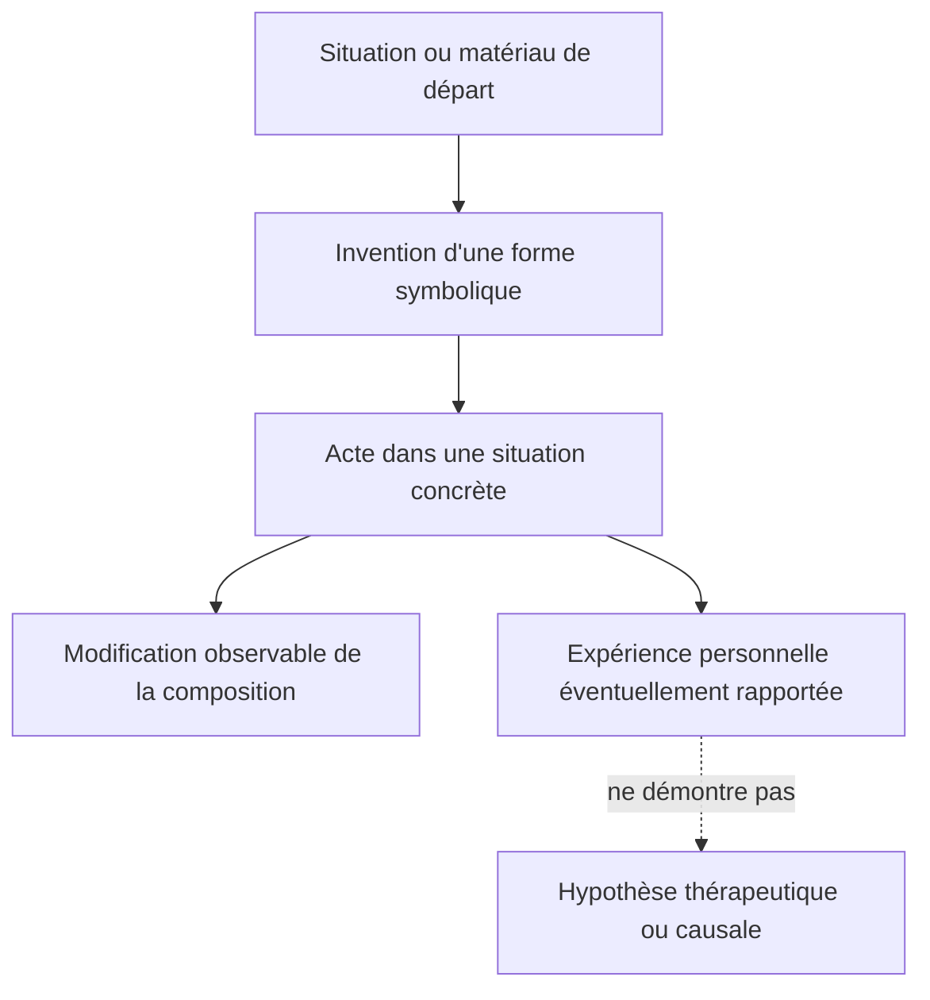

# Alejandro Jodorowsky — dossier fondateur, étape 1
## De l'acte poétique à la transformation symbolique
Atlas 3 · 26 novembre 2026 · Brouillon de recherche, non intégré au lecteur. Cette première étape ne remplace ni le dossier Jung ni le chantier tarot de l'Atlas 4.

### I. Le problème propre de Jodorowsky
Le Théâtre du sentir dispose déjà de méthodes pour travailler la sensation, l'action et l'imagination. Jodorowsky introduit une autre question : que peut changer le fait de donner à une expérience une forme d'action symbolique plutôt que de seulement la raconter ? Cette question doit être distinguée de la prétention thérapeutique que l'auteur associe à sa pratique.

### II. Une genèse artistique : du mime au happening
Dans l'entretien du dossier de presse de Psychomagie, un art pour guérir (2019), Jodorowsky reconstruit son itinéraire depuis la pantomime et le théâtre jusqu'à des événements centrés sur l'acte. Ce récit autobiographique renseigne sa conception tardive de son parcours ; il ne suffit pas à établir une histoire exhaustive du mouvement Panique. Dans son entretien Fnac de 2019, il revient sur la différence entre des actions destructrices du happening et ce qu'il entend désormais par acte poétique. [AJ1, AJ2]

Pour Atlas 3, un événement scénique ne se mesure pas seulement à sa violence, à sa surprise ou à son intensité. L'acte modifie une relation entre un corps, un objet, une situation et un témoin. Il faut examiner la nature concrète du changement, plutôt que sacraliser le choc.

### III. Acte poétique, théâtre éphémère et acte psychomagique
Trois distinctions provisoires, reconstruites à partir des entretiens, non une taxonomie exhaustive de l'auteur :
- Acte poétique : une invention qui fait varier la manière habituelle d'agir et la signification d'un geste.
- Théâtre éphémère : événement organisé autour d'une action singulière, plutôt qu'une œuvre dramatique nécessairement fondée sur un texte.
- Acte psychomagique : action personnalisée que Jodorowsky propose dans une intention de transformation personnelle, à partir de sa conception de l'inconscient et du symbole.

Leur point commun est la matérialisation de l'imagination ; leur différence tient à la situation, au destinataire et à la finalité. L'invention scénique n'a pas besoin d'une promesse de guérison pour posséder sa valeur propre.

### IV. Le langage métaphorique et ses limites
Jodorowsky attribue aux actes et aux images une efficacité particulière sur l'inconscient. Il oppose cette proposition à sa lecture de la psychanalyse verbale. Il ne faut pas transformer cette opposition autobiographique en description équitable de toutes les psychothérapies. Le modèle de la psychomagie, son efficacité médicale alléguée et sa théorie de la réception des symboles ne sont pas établis par l'entretien ni par les récits de cas qu'il rapporte. [AJ1, AJ2]
Un changement éprouvé peut être réel sans que sa cause soit connue. Les attentes, le contexte relationnel, l'engagement et les circonstances concrètes doivent rester examinables. Le témoignage ne permet pas à lui seul de déterminer ce qui aurait eu lieu en l'absence de l'acte.

### V. Le paradoxe de la liberté : inventer ou obéir
L'acte proposé par un tiers soulève une difficulté : la personne peut-elle devenir plus libre en exécutant une prescription extérieure ? La capacité d'inventer, de modifier ou de refuser une proposition est un critère de notre adaptation artistique. On ne transforme pas les récits de Jodorowsky en recettes autonomes, notamment lorsqu'ils comportent ingestion de substances, atteintes corporelles, exposition intime ou risques pour autrui. Aucun acte humiliant, intrusif ou dangereux ne devient acceptable par sa qualification de symbolique.

### VI. Métagénéalogie : répétition et invention
Dans l'extrait du chapitre II de Metagenealogy, Jodorowsky et Marianne Costa présentent une tension entre imitation familiale et création, inscrite dans une représentation spirituelle de la conscience. Ils imaginent des cercles allant de l'individu au groupe familial, puis à la collectivité et à un horizon cosmique. [AJ3] L'intérêt pour Atlas 3 est de confronter héritage et possibilité d'inventer une réponse différente. Le cadre cosmologique appartient aux auteurs et non à une psychologie démontrée.
On distinguera dans une future lecture : faits généalogiques établis, souvenirs et récits familiaux, hypothèses sur les habitudes acquises, associations symboliques, spéculations spirituelles. On ne déduit pas une maladie, une dette inconsciente ou une destinée d'un prénom, d'une date ou d'une ressemblance. Les membres d'une famille ne doivent pas être rendus responsables par une lecture divinatoire. Marianne Costa sera créditée comme coauteure de ce corpus.

### VII. Première partition originale Atlas : trois usages d'un objet
Une chaise reste vide pendant toute une courte scène. Écrire ou jouer trois versions : une chaise que personne ne remarque ; une chaise que l'on réserve à un absent ; une chaise qu'un personnage offre à un nouveau venu. Observer les changements de rythme, de distance et de relation. Puis inventer une quatrième version en changeant seulement l'action de l'un des personnages.
Il s'agit d'une composition fictive et libre, pas d'un acte psychomagique prescrit ni d'une exposition autobiographique. La valeur du travail se juge à la différence perceptible entre les versions.

### VIII. Correspondances à développer, sans assimilation
Jung : le rapport à l'image et à l'inconscient, mais l'imagination active ne se réduit pas à un acte prescrit.
Chekhov : une image peut infléchir un geste ; son objectif est la création d'un rôle.
Winnicott : les conditions du jeu, notamment la liberté de ne pas accepter une proposition.
Gendlin : l'expérience située peut trouver une forme qui lui répond, sans qu'une signification soit imposée d'avance.
Ces comparaisons sont des hypothèses de lecture Atlas, non des filiations historiques démontrées.

### IX. Premier schéma de lecture

Ce diagramme appartient à Atlas 3, il ne représente pas un protocole clinique de Jodorowsky. Il sépare la création d'un acte, l'observation et l'interprétation.

### X. Répartition Atlas 3 / Atlas 4
Atlas 3 : imagination, théâtre Panique, acte poétique, psychomagie comme objet critique, métagénéalogie et possibilité de création. Atlas 4 : tarot et cartes, histoire iconographique, structure des systèmes symboliques, cosmologies. La Voie du tarot, avec Marianne Costa, sera mobilisée dans Atlas 3 uniquement pour les passages nécessaires à la pensée de l'imagination et de l'interprétation ; ne pas recopier le futur dossier des 78 cartes.

### XI. Sources et limites de cette étape
[AJ1] Jodorowsky, entretien du dossier de presse de Psychomagie, un art pour guérir, Nour Films, 2019, réponses sur la genèse, le théâtre éphémère, le symbole et le rituel. Texte extrait directement consulté ; pas de visionnage du film. https://www.fifib.com/storage/wsm_medias/H90Zx9fHaCTjCazu1L3NYqgA4pGBbf3nyTeoyCXj.pdf
[AJ2] Entretien Fnac 2019, sur l'imagination et les happenings. Texte directement consulté. https://leclaireur.fnac.com/article/cp45917-interview-dalejandro-jodorowsky-il-ny-a-pas-dechec-rater-cest-juste-changer-de-chemin/
[AJ3] Alejandro Jodorowsky et Marianne Costa, Metagenealogy, Park Street Press, 2014, extrait du chapitre II publié par le distributeur ; non lecture intégrale. https://www.simonandschuster.com/books/Metagenealogy/Alejandro-Jodorowsky/9781620551035
[AJ4] Le Théâtre de la guérison et Psychomagie : ouvrages repérés, lecture ciblée à entreprendre. Notice bibliographique : https://www.bnfa.fr/livre?biblionumber=56937
[AJ5] Étude secondaire « Le théâtre de la guérison : une thérapie panique », Marges 24, repérée, texte intégral non consulté (accès HTML bloqué). https://journals.openedition.org/marges/1260

### XII. Suite du travail
Lire les chapitres de l'ouvrage sur les actes poétique, théâtral, onirique et magique, puis la psychomagie ; vérifier les sources historiques sur Panique ; approfondir le statut de la prescription, les concepts de métagénéalogie et l'apport de Marianne Costa. Construire ensuite le lexique et les schémas, après contrôle des termes. Aucun changement apporté au lecteur, à main ou aux Atlas 1, 2 et 4 dans cette étape.
