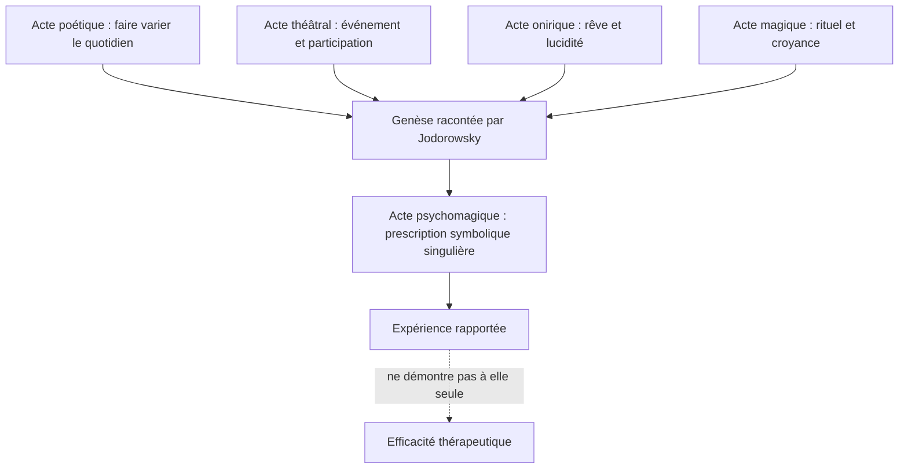

# Jodorowsky — dossier fondateur, étape 2 : les cinq actes et la question de la liberté
Atlas 3 · 26 novembre 2026 · Suite de jodorowsky-fondateur-01-acte-poetique-brouillon.md. Recherche préparatoire, non intégrée au lecteur.

## XIII. Une architecture issue des entretiens
La première partie de Psychomagic (édition anglaise 2010, entretiens avec Gilles Farcet) suit cinq chapitres : l'acte poétique, théâtral, onirique, magique et psychomagique. L'auteur présente leur succession comme la genèse de sa démarche, non comme cinq étapes obligatoires pour le lecteur. [AJ6]

## XIV. L'acte poétique : faire surgir une autre possibilité
Jodorowsky revient sur ses expériences avec Enrique Lihn et distingue rétrospectivement l'invention constructive de la simple réaction destructrice. [AJ6, chap. I]
Pour le Théâtre du sentir, la question devient : un changement minime dans l'usage d'un objet permet-il de percevoir autrement une situation ? Une tasse abandonnée sur une table n'a pas besoin d'être transformée en symbole universel. Sa place, la durée du regard, le fait de la tendre à quelqu'un peuvent déplacer l'action. Le travail n'exige pas de transgression publique. L'étrangeté est un moyen parmi d'autres, pas un critère de profondeur.

## XV. L'acte théâtral : un événement plutôt qu'une représentation répétée
Dans son analyse des éphémères paniques, Elisabeth Pouilly montre la place du lieu, de l'improvisation et de la participation du public. Le collectif Panique, fondé en 1962 avec Fernando Arrabal et Roland Topor, fournit un contexte à la recherche de Jodorowsky sur le caractère non reproductible de l'événement. [AJ7, pp. 47–49]
Question Atlas : que change la présence d'une personne qui n'est pas seulement destinataire d'une représentation ? Une scène peut s'ouvrir à l'imprévu sans supprimer le cadre de fiction. Le droit du partenaire à ne pas participer distingue une invitation d'une contrainte. L'histoire de certaines performances violentes appartient à l'étude critique ; elle ne constitue pas un répertoire d'exercices.
Raccord : Chekhov travaille la composition du personnage et ses qualités d'action ; la recherche panique conteste la séparation de l'acteur et de l'événement. Les deux ne définissent pas le même théâtre.

## XVI. L'acte onirique : une conscience à l'intérieur de l'imaginaire
Le chapitre III évoque des rêves lucides et transpose l'idée du témoin à la perception du quotidien. [AJ6]
Pour Atlas 3, la distinction entre image et événement extérieur doit subsister. Une fiction peut mettre en scène un personnage qui prend conscience de rêver, sans transformer cette fiction en théorie de la réalité. Une personne éveillée n'a pas à traiter son environnement comme un rêve ni à chercher des signes occultes dans des coïncidences.
Correspondance avec Jung : tous deux accordent une place à la relation consciente avec l'imaginaire, mais rêve lucide et imagination active ne sont pas synonymes. Le travail sur une image à l'état éveillé n'est pas un rêve lucide.

## XVII. L'acte magique : le dispositif et le statut de la croyance
Le chapitre IV décrit des pratiques rituelles rencontrées au Mexique, notamment celles de Pachita ; le prologue oppose le dispositif de croyance des guérisseurs à l'idéal d'une psychomagie dont le consultant comprend le geste. [AJ6, AJ8]
Décomposer une scène rituelle du point de vue artistique : objets, espace, rythme, parole, autorité attribuée, attente du participant. Chacun de ces éléments peut infléchir l'expérience ; aucun ne démontre une force surnaturelle. Le récit de Jodorowsky n'est ni une enquête ethnographique exhaustive ni une preuve de guérison. Les traditions mexicaines ne sont pas interchangeables avec une catégorie générale de magie. Le corpus historique des rituels appartient à Atlas 4.

## XVIII. L'acte psychomagique : la prescription et la contradiction interne
Dans le chapitre V, Jodorowsky insiste à la fois sur la singularité de la prescription, son exécution précise et son refus déclaré de diriger l'existence du consultant. Les lettres de retour au chapitre VII clôturent l'acte dans son dispositif. [AJ6]
Voilà le problème propre à notre projet : une invitation à inventer et une obligation de se conformer à une prescription peuvent entrer en conflit. Atlas 3 retient la capacité du participant à choisir, modifier, refuser, interrompre. Les témoignages publiés renseignent les expériences rapportées, non un taux de réussite ni une causalité clinique. Aucune consigne médicale ou d'abandon de traitement ne peut en découler. Ne pas diffuser d'actes dangereux ou humiliants sous la forme de recettes.

## XIX. Une carte des cinq actes

Cette carte retrace des influences et non une méthode à suivre. Elle complète la carte de l'étape 1. Les quatre premières branches conservent leur autonomie artistique et historique.

## XX. Deuxième partition originale : trois rapports au même objet
Dans une pièce fictive, un personnage trouve une clé. Première version : elle sert à ouvrir une porte. Deuxième : la porte est déjà ouverte, et la clé devient un objet que le personnage refuse de transmettre. Troisième : l'autre acteur donne à la clé un usage imprévu, choisi dans un cadre de jeu convenu. Reprendre les versions en variant la distance des corps et le silence. Comparer ce qui change dans l'action. Aucune signification psychologique préalable n'est imposée. Ni révélation intime ni acte psychomagique réel.

## XXI. Lexique provisoire à confronter aux sources
Candidats : acte poétique, acte théâtral, éphémère panique, théâtre-conseil, acte onirique, rêve lucide, témoin, acte magique, piège sacré, acte psychomagique, prescription singulière, langage symbolique, désidentification, retour écrit, métagénéalogie. Ces libellés ne sont pas tous des concepts canoniques : distinguer les mots de l'auteur des outils éditoriaux Atlas. L'entrée métagénéalogie doit être fondée sur l'ouvrage cosigné avec Marianne Costa et non attribuée à Jodorowsky seul. À approfondir également : psychotranse, imagination créatrice et les rapports avec le tarot.

## XXII. Sources de cette étape
[AJ6] Alejandro Jodorowsky, Psychomagic: The Transformative Power of Shamanic Psychotherapy, Inner Traditions, 2010, sommaire et passages sélectionnés des chapitres I (discussion sur la construction et la destruction), II (lieu et événement), III (rêve lucide), IV–V (rituel, prescription), VII (lettres). Reproduction anglaise : https://esotericlibrary.weebly.com/uploads/5/0/7/7/5077636/alejandro-jodorowsky_-__psychomagic-the-transformative-power-of-shamanic-psychotherapy.pdf . Texte extrait consulté, couverture contrôlée visuellement seulement ; pas de collation des pages de l'édition française, pas de lecture exhaustive.
[AJ7] Elisabeth Pouilly, « Le théâtre de la guérison : l'expérience psychomagique d'Alexandro Jodorowsky », Marges 24, 2017, pp. 45–56, passages sur Panique et l'acte théâtral, texte extrait consulté ; tentative de contrôle visuel p. 3 échouée (redirection HTML). https://journals.openedition.org/marges/pdf/1260 ; DOI 10.4000/marges.1260. Analyse en histoire de l'art, non étude d'efficacité clinique.
[AJ8] Prologue de Psychomagic, extrait autorisé sur le site du distributeur : https://www.simonandschuster.net/books/Psychomagic/Alejandro-Jodorowsky/9781594779565 . Notice de l'édition française : https://www.albin-michel.fr/le-theatre-de-la-guerison-9782226326980 .
Les exemples et diagrammes sont originaux. Les comparaisons inter-auteurs sont éditoriales. Aucun changement sur main ni dans les Atlas 1, 2 et 4.
