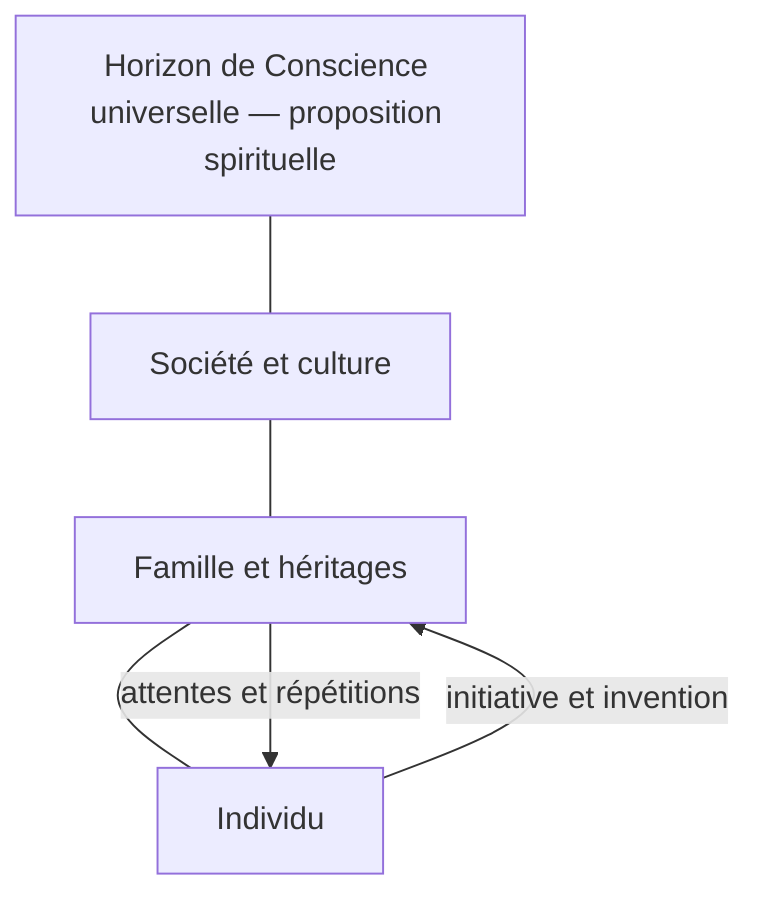
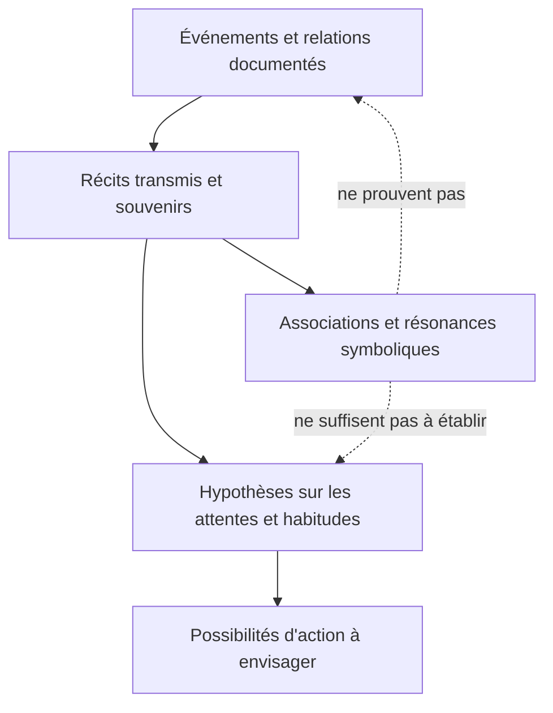
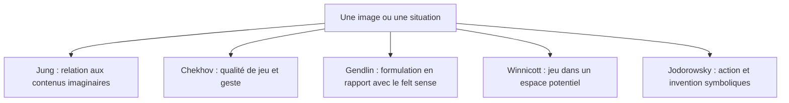

# Jodorowsky et Marianne Costa — dossier fondateur, étape 3 : héritage, imagination et horizon spirituel
Atlas 3 · 26 novembre 2026 · Suite directe des étapes 01 et 02. Lecture ciblée des extraits éditoriaux et entretiens, non lecture intégrale des livres. Les rapprochements et ateliers proposés sont des créations Atlas.

## XXIII. Métagénéalogie : une œuvre à deux voix
Le sous-titre anglais de Metagenealogy (2014) situe le projet entre connaissance de soi, psychomagie et arbre familial. Le chapitre II expose une conception du devenir individuel qui dépasse l'enquête généalogique. Les auteurs relient héritage et création à un horizon spirituel. Il faut restituer cette construction en créditant Marianne Costa comme coauteure, et non comme simple commentatrice de Jodorowsky. [AJ9]
Le terme métagénéalogie ne désigne pas ici la recherche archivistique des liens de parenté. C'est leur interprétation symbolique et spirituelle. La connaissance factuelle d'un lien familial n'établit pas sa signification psychologique.

## XXIV. La force imitatrice et la force créatrice
Dans le chapitre II, les auteurs opposent la reproduction des formes héritées à une puissance créatrice qu'ils rattachent à la Conscience universelle. Le passé fournit des attentes et des habitudes ; la possibilité d'un avenir inédit donne une autre portée à cet héritage. [AJ9]
Il ne s'agit pas, pour eux, seulement de s'émanciper des parents : ils pensent une transformation qui concerne également les cercles plus larges de la société et de la culture. Cette conception comporte une affirmation métaphysique, distincte de l'observation ordinaire de l'apprentissage social.
Exemple Atlas : un personnage reprend une entreprise familiale parce que cette perspective lui a toujours semblé naturelle. Dans une deuxième version il s'en détourne ; dans une troisième il l'aménage en un lieu de création. Aucune des réponses n'est par nature la plus libre. Observer le contexte et les contraintes de chaque décision. La nouveauté ne se confond pas avec le refus de tout héritage.

## XXV. Les cercles de la conscience
Les auteurs représentent l'individu, la famille, la collectivité et un horizon cosmique à l'aide de cercles concentriques. [AJ9] Le diagramme ci-dessous restitue l'organisation de leur pensée ; les relations ne sont pas des structures psychiques observées.

La disposition en niveaux sert ici la lisibilité ; le modèle original de l'extrait les imagine emboîtés. Une version picturale en anneaux pourra être intégrée ultérieurement. Ne pas confondre l'inconscient collectif de Jung avec la Conscience universelle de Jodorowsky et Costa : le premier est une hypothèse de dispositions psychiques communes, la seconde un horizon métaphysique et créateur.

## XXVI. Rôle familial, obstacle et nouvelle action
Le même chapitre examine les places valorisées et stigmatisées dans le groupe familial et fait des obstacles une matière de transformation. [AJ9]
Une place attribuée peut devenir une contrainte ; elle peut aussi être choisie, redéfinie ou abandonnée. Il n'est pas légitime de conclure d'une maladie, d'une addiction ou d'un échec à l'existence d'un mandat familial invisible. Les difficultés n'ont pas toutes une fonction initiatique et aucune souffrance ne doit être justifiée par une prétendue nécessité spirituelle.
Le Théâtre du sentir retient un problème de composition : rendre perceptible la différence entre un rôle attendu, une conduite réellement accomplie et les alternatives que la situation rend possibles.

## XXVII. L'arbre : distinguer document, récit et interprétation
Carte de méthode originale Atlas ; non protocole canonique de métagénéalogie.

Un arbre personnel peut mêler des informations confirmées, contradictoires ou inconnues. Conserver l'incertitude au lieu de la remplir par des correspondances de prénoms ou de dates. L'enquête n'oblige ni à solliciter ses proches ni à dévoiler leur intimité. Les exercices proposés dans Atlas restent fictifs ou librement choisis.

## XXVIII. L'imagination comme expérience incarnée
Dans l'entretien d'ActuaLitté (2024), Jodorowsky rapproche le pouvoir d'inventer du fait d'éprouver les images par le corps ; il associe cette démarche au surréalisme et à la poésie. [AJ10]
Pour comprendre cet aspect artistique, distinguer la formation d'une image, les sensations qu'elle suscite et les effets de son expression. Le fait d'éprouver une représentation avec intensité ne transforme pas son contenu en événement physique. Une scène peut faire exister pour son public une situation absente par l'espace, le geste et la voix. C'est une puissance de la forme artistique, et non une preuve de magie.
Raccord Chekhov : une image peut orienter l'action de l'acteur sans exiger un souvenir intime. Raccord Gendlin : le rapport entre sensation et formulation n'est pas la même opération que l'invention volontaire d'une image. Raccord Ansa : l'accueil de l'expérience sensible ne se confond pas avec la production imaginaire d'une expérience.

## XXIX. La psychotranse : continuité et déplacement
Dans un entretien de 2020, Jodorowsky décrit la psychotranse comme un prolongement de la psychomagie qui combine écriture et exercices, en recherchant une modification de l'expérience sans recours aux drogues. [AJ11] En 2024 paraît La Voie de l'imagination : De la psychomagie à la psychotranse. [AJ10]
Le passage du geste prescrit à une expérience imaginative et corporelle mérite un examen plus poussé de l'ouvrage. La source accessible ici est un entretien, non un exposé exhaustif de la méthode. L'absence de substances ne suffit pas à garantir l'innocuité d'une induction. Atlas étudiera le concept, sans proposer d'exercice de dissociation, d'hallucination ou de transe intense. Une pratique de composition attentive, effectuée à l'état ordinaire, n'est pas une psychotranse.

## XXX. Spiritualité : l'art comme déplacement du rapport à soi
Dans l'entretien publié par Psychologies, Jodorowsky décrit son idéal de création cinématographique comme un effacement de la prétention de l'ego à gouverner l'œuvre, au profit d'une force qu'il qualifie d'universelle. [AJ12]
Cette conception permet de poser le problème de l'attention au matériau : un artiste peut découvrir ce que le travail en cours exige, au lieu de lui imposer son projet initial. Mais cet idéal artistique et l'affirmation spirituelle ne sont pas équivalents. La modestie de l'auteur ne suppose pas l'abolition de son jugement, de sa responsabilité ou de ses limites corporelles.
Les récits de psychomiracles et les allégations de guérison dans le même entretien ne constituent pas des preuves médicales. Le présent dossier les traite comme des éléments de sa doctrine, non comme des phénomènes établis ou des consignes.
Raccord futur Gurdjieff : étudier la question de l'identification, sans postuler une filiation doctrinale. Raccord Jung : différencier le moi et le Soi, sans les assimiler à l'effacement de l'ego évoqué par Jodorowsky.

## XXXI. Le tarot comme image à lire, non comme verdict
Dans l'extrait du chapitre consacré à L'Amoureux, Jodorowsky et Costa étudient notamment l'ambiguïté des gestes, des regards et de l'appartenance d'un bras. Ils envisagent des interprétations relationnelles divergentes à partir de la même image. [AJ13] Dans l'entretien de 2020, Jodorowsky écarte l'usage prédictif du tarot au profit d'une lecture de l'inconscient. [AJ11]
Nous pouvons retenir une méthode de description et d'invention : regarder une forme avant de lui assigner une signification, puis comparer les lectures possibles. Cette opération ne démontre pas que les cartes révèlent la personnalité d'une personne. L'histoire et l'iconographie des 78 cartes, leurs variantes et le système interprétatif complet des auteurs sont réservés à Atlas 4. Les allégations historiques de l'éditeur sur l'ancienneté du Tarot de Marseille demandent une vérification indépendante dans ce futur dossier.

## XXXII. Troisième partition : une image, plusieurs relations
Dans une image fictive, trois personnes se tiennent près d'une porte. Décrire les positions sans interpréter. Composer deux mises en scène qui conservent les mêmes positions mais changent l'initiative d'un regard et le destinataire d'un geste. Écrire une phrase pour chacune, sans décider d'emblée laquelle est vraie. Rejouer en modifiant le rythme.
Cette partition ne reproduit aucune carte et ne vise pas la divination. Le critère est la différence sensible et dramatique produite par les choix. Elle peut servir de passage de la culture de l'imaginaire au théâtre et à l'expression.

## XXXIII. Carte comparative des opérations

Ce rapprochement est une carte éditoriale de questions, pas un arbre généalogique des théories. Les cinq démarches ne partent pas nécessairement d'une image : Gendlin notamment travaille à partir d'un sens corporel implicite de la situation. Elles possèdent des buts et des statuts différents.

## XXXIV. Sources et travail restant
[AJ9] Jodorowsky et Costa, Metagenealogy, 2014, chapitre II, extrait éditorial « The Role of Obstacles », directement lu : https://www.simonandschuster.com/books/Metagenealogy/Alejandro-Jodorowsky/9781620551639 . Pas de lecture intégrale.
[AJ10] Nicolas Gary, entretien avec Jodorowsky, ActuaLitté, 29 août 2024, passages sur la Voie de l'imagination, le corps et le surréalisme : https://actualitte.com/article/118917/interviews/alejandro-jodorowsky-la-psychomagie-c-est-une-liberation . Ouvrage de 2024 repéré, non consulté intégralement.
[AJ11] Budd Wilkins, entretien avec Jodorowsky, Slant, 8 août 2020, réponses sur le tarot, le cinéma autobiographique et la psychotranse : https://www.slantmagazine.com/film/interview-alejandro-jodorowsky-on-psychomagic-the-theater-of-cruelty-and-more/ . Entretien directement lu ; films non visionnés dans cette étape.
[AJ12] Entretien « Guérir, c'est être soi », Psychologies, passages sur l'état de conscience et le cinéma : https://www.psychologies.com/Therapies/Toutes-les-therapies/Therapeutes/Interviews/Alexandro-Jodorowsky-Guerir-c-est-etre-soi . Témoignage de l'auteur, non validation indépendante.
[AJ13] Jodorowsky et Costa, The Way of Tarot, 2009, extrait du chapitre VI publié par le distributeur : https://www.simonandschuster.net/books/The-Way-of-Tarot/Alejandro-Jodorowsky/9781594772634 . Lecture ciblée, non lecture intégrale.
Suite : constituer le lexique sourcé en distinguant notions d'auteur et outils Atlas ; consolider les trois brouillons dans le lecteur, organiser leurs schémas et leurs trois partitions ; vérifier les rapprochements existants avant tout ajout. Aucun changement sur main ni dans les Atlas 1, 2 et 4.
