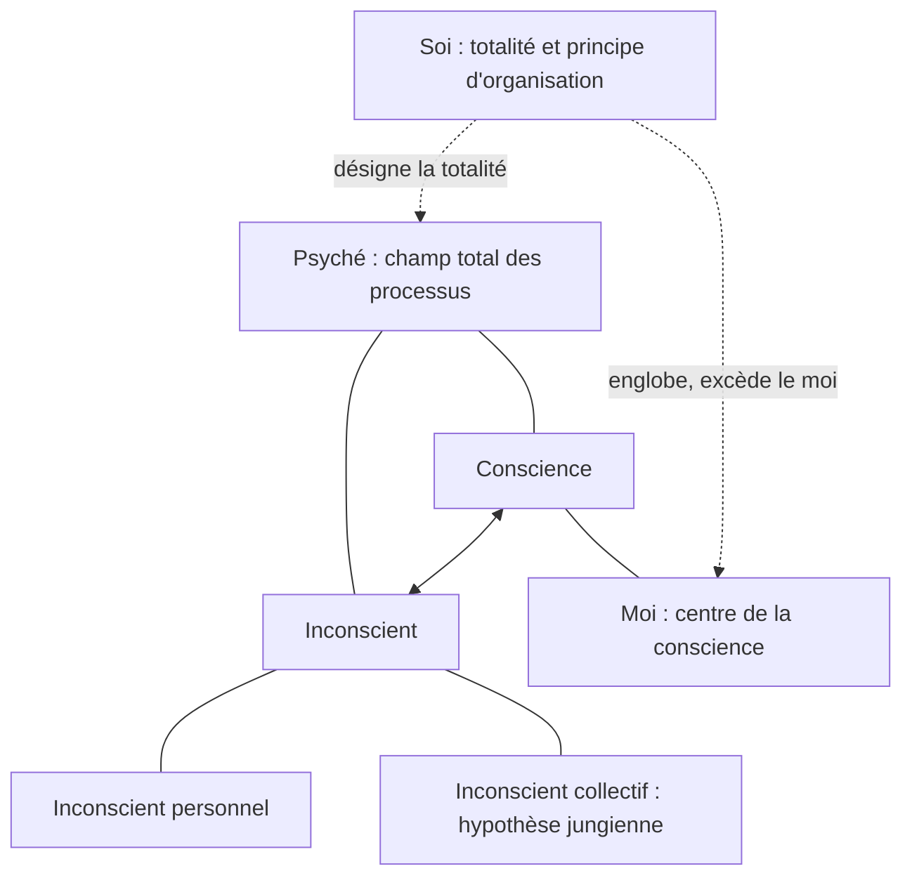
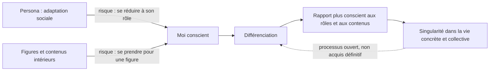
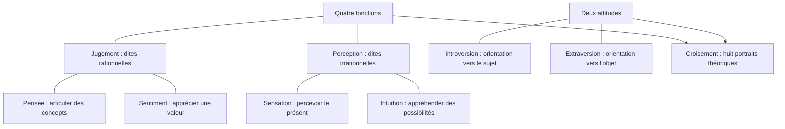
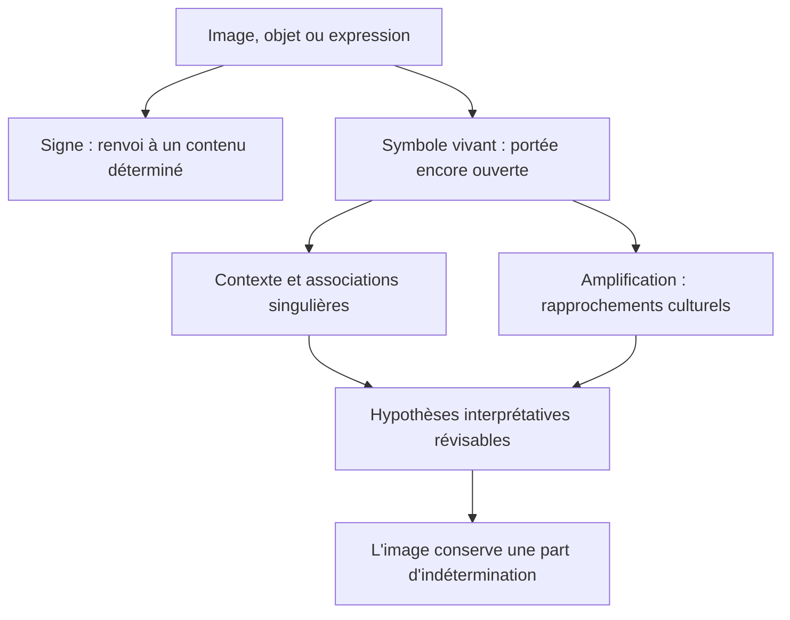
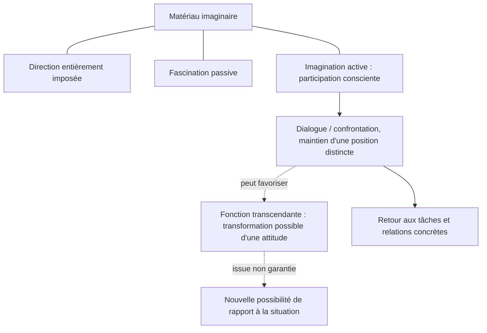

# Jung — Atlas visuel de la psychologie analytique · prototype V1

26 novembre 2026 · Atlas 3, Théâtre du sentir · complément au dossier fondateur, sans remplacement de son texte ni de ses 62 notices. Cinq schémas pédagogiques originaux à tester dans le lecteur. Les références J1–J16 sont celles des brouillons du dossier, et non des sources nouvellement collationnées ici. Les diagrammes représentent des relations dans une théorie historique, pas des structures cérébrales ou des mécanismes empiriquement établis.

## 1. Architecture de la psyché

**À retenir.** Le moi n'est pas le Soi ; le Soi n'est pas un compartiment supplémentaire de l'inconscient. La liaison conscience/inconscient représente leur rapport dynamique, non un accès complet et volontaire. Les deux distinctions de l'inconscient ne sont pas des frontières étanches.

Lecture : dossier 01, III et IX ; Aïon, chap. I–II [J2]. Notices : moi, conscience, inconscient personnel, inconscient collectif, Soi. La persona et l'ombre font l'objet d'une carte distincte plutôt que d'être assignées à un emplacement anatomique.

## 2. Individuation : deux identifications à distinguer

**À retenir.** Une persona est aussi une fonction utile. Reconnaître un contenu intérieur ne signifie ni lui obéir ni devoir le jouer. L'individuation ne se confond pas avec l'individualisme. Le schéma synthétise deux risques, non des étapes obligatoires ou une promesse de transformation.

Lecture : dossier 01, V–VI, VIII–XI ; CW 7 §§ 245–247, 266–267, 296–406 [J1/J1s], Aïon [J2]. Exemple Atlas : une régisseuse peut conserver sa compétence professionnelle sans être tenue de jouer le même rôle dans toutes ses relations.

## 3. Types psychologiques : fonctions et attitudes

**À retenir.** Sentiment ne veut pas dire émotion intense ; irrationnel ne veut pas dire absurde. Introversion et extraversion ne sont pas des mesures de sociabilité. Les huit portraits ne constituent pas huit catégories exhaustives ; ce schéma n'est pas un test MBTI. La fonction auxiliaire et la fonction inférieure feront l'objet d'une carte secondaire, sans imposer une pile de fonctions moderne.

Lecture : dossier 02, XV–XVI ; Types psychologiques, chap. X et section 11 [J10–J11]. Atelier existant : une situation, quatre opérations. Correspondance : distinguer le sentiment jungien, le sentir d'Ansa et le felt sense de Gendlin.

## 4. Signe, symbole et travail de l'image

**À retenir.** Il ne s'agit pas de classer définitivement les objets en signes ou symboles : le rapport du sujet à l'expression importe. L'amplification n'est pas un dictionnaire universel des images et la similarité ne prouve pas une origine commune. Une interprétation n'est pas un fait sur autrui.

Lecture : dossier 02, XVII–XIX ; Types psychologiques, chap. XI, entrée Symbol [J12] ; CW 7 §§ 121–122 [J1/J9]. Exemple : une assiette supplémentaire peut être un indice déterminé dans un récit ou un motif dont les résonances restent ouvertes. Atlas 4 pourra développer les corpus iconographiques, sans dupliquer cette explication psychologique.

## 5. Imagination active et fonction transcendante : deux notions distinctes

**À retenir.** Les trois positions constituent une distinction pédagogique Atlas, pas une classification canonique de Jung. Ce dessin n'est pas un protocole à suivre seul. L'imagination active ne se confond ni avec l'écriture de fiction, ni avec la fonction transcendante. Une image n'établit pas un fait extérieur. La fonction transcendante n'implique pas une synthèse obligatoire.

Lecture : dossier 03, XXI–XXIX ; CW 7 §§ 341–373 et CW 8 §§ 168–189 [J14–J16]. Pratique Atlas déjà disponible : « laisser la fiction répondre », explicitement distincte de la démarche clinique. Correspondances : Chekhov, Winnicott, IFS — ne pas assimiler leurs méthodes.

## Intégration proposée (non réalisée)

- Conserver le texte intégral comme parcours par défaut, avec son sommaire existant.
- Ajouter ces cinq cartes près des sections correspondantes et dans une entrée « Concepts et schémas » ; une carte ne possède qu'une source éditoriale, réutilisée à plusieurs endroits.
- Chaque nœud significatif pourra renvoyer vers la notice existante du lexique, après contrôle de son identifiant ou de son libellé exact. Ne pas créer des définitions concurrentes.
- Garder les pratiques et correspondances comme entrées complémentaires, sans créer de copie du dossier.
- Lors de l'intégration : SVG responsive, contraste suffisant, texte sélectionnable ou équivalent HTML, lecture sans dépendre des couleurs, lien de retour au dossier ; vérifier sur mobile, sans modifier Atlas 1 et 2.
- Prochain lot visuel : constellation d'un complexe, ombre et projection, distinction archétype/image archétypique, rêve et compensation, figures du Soi. Les corpus d'images historiques de l'alchimie et du mandala seront préparés séparément pour Atlas 4.
- Les cinq diagrammes ci-dessus ont été rédigés et contrôlés conceptuellement à partir des sections indiquées ; leur rendu Mermaid, leur navigation et leur intégration dans le lecteur restent à tester. Aucun changement sur main.

