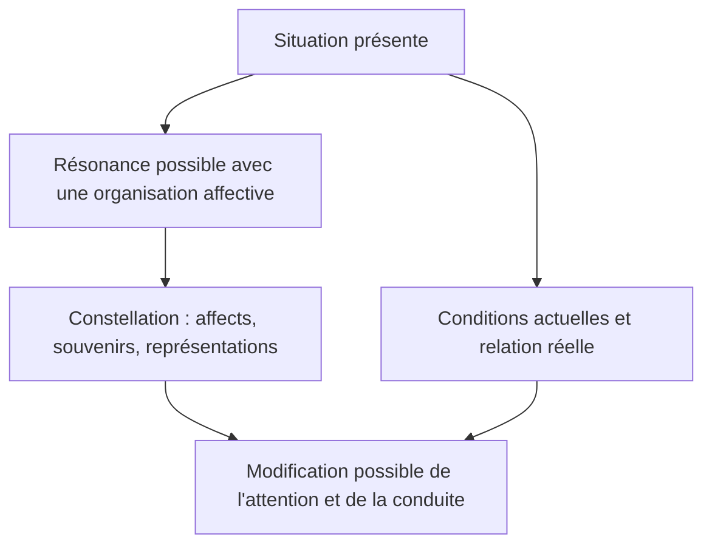
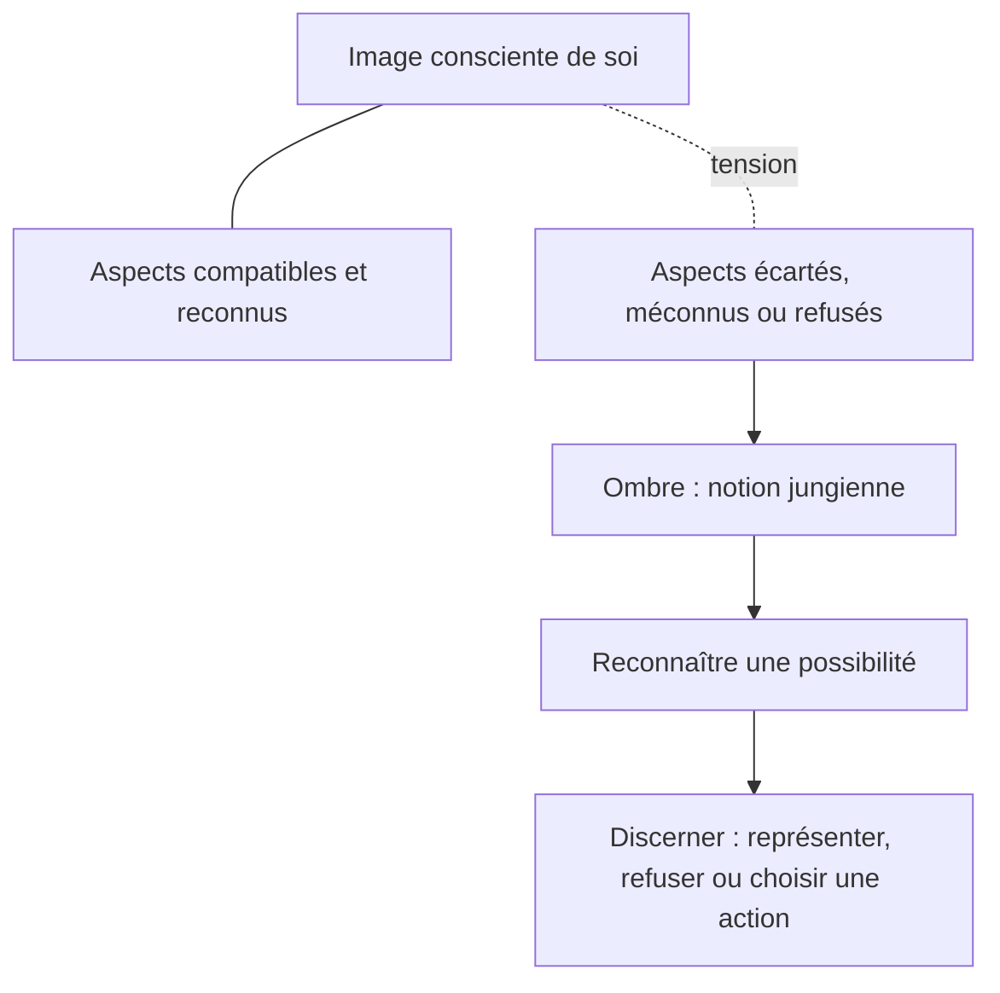
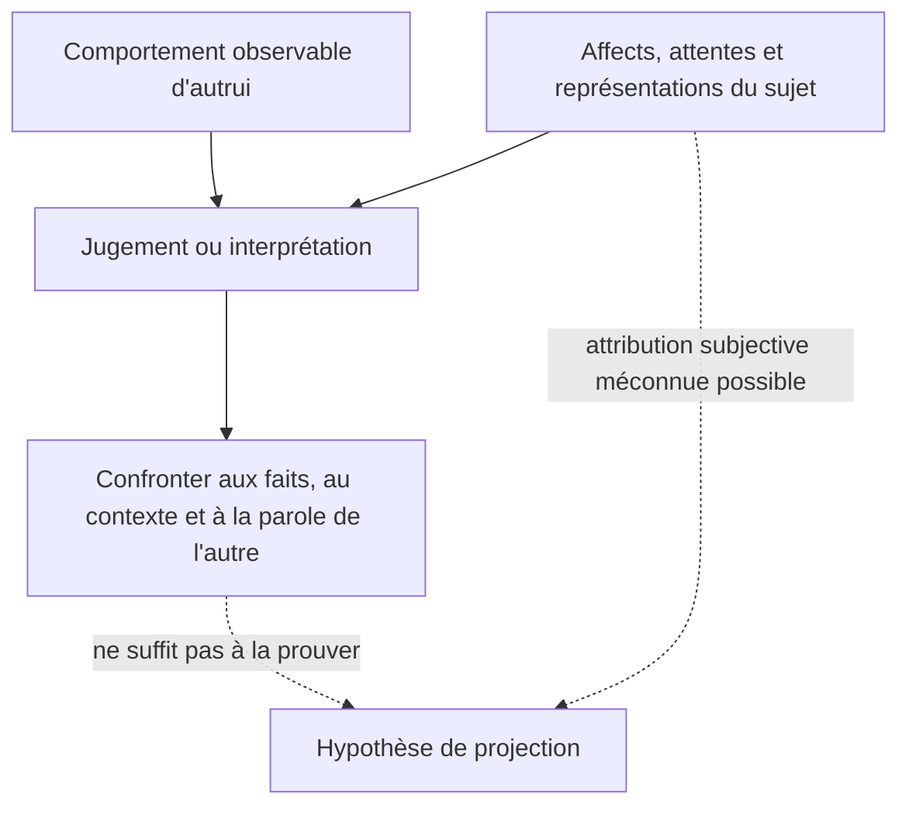
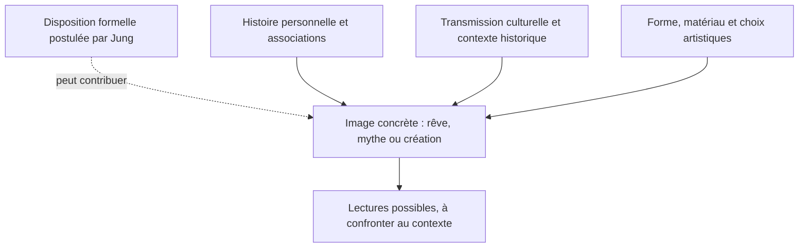
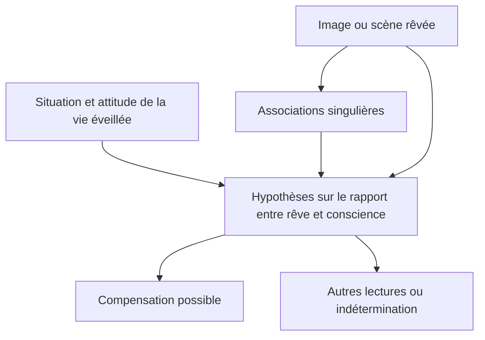
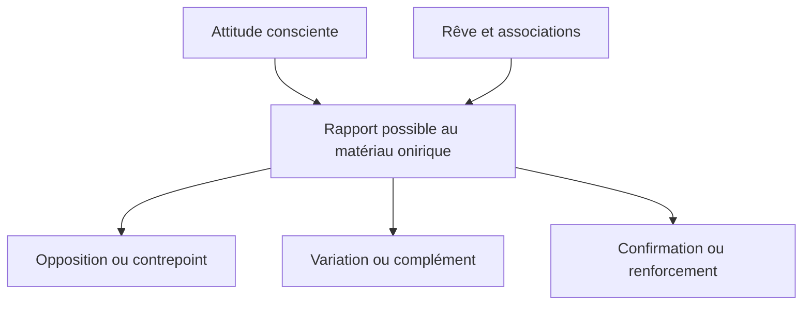
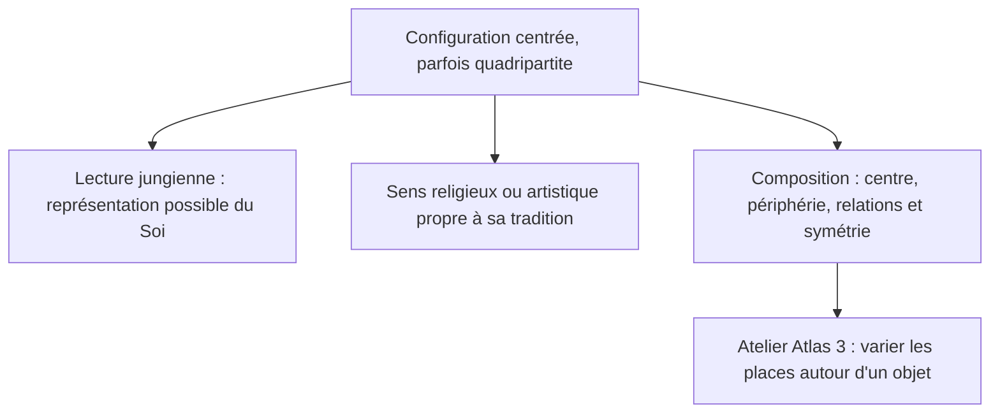
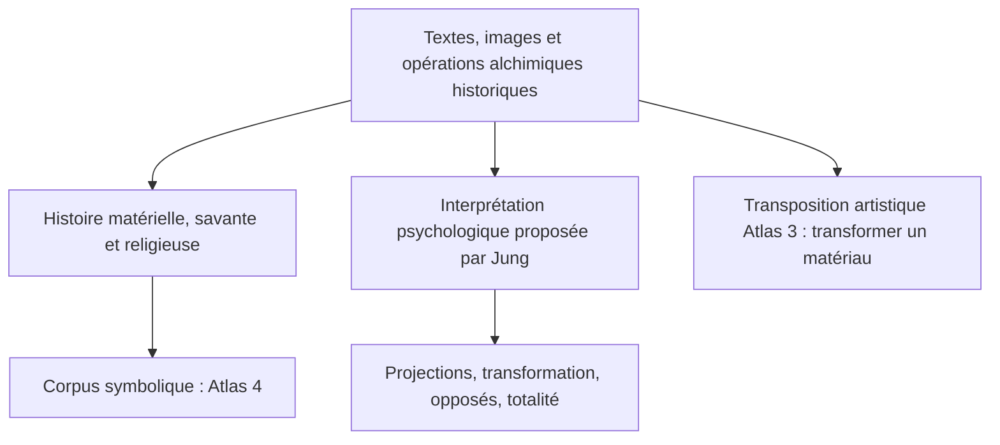
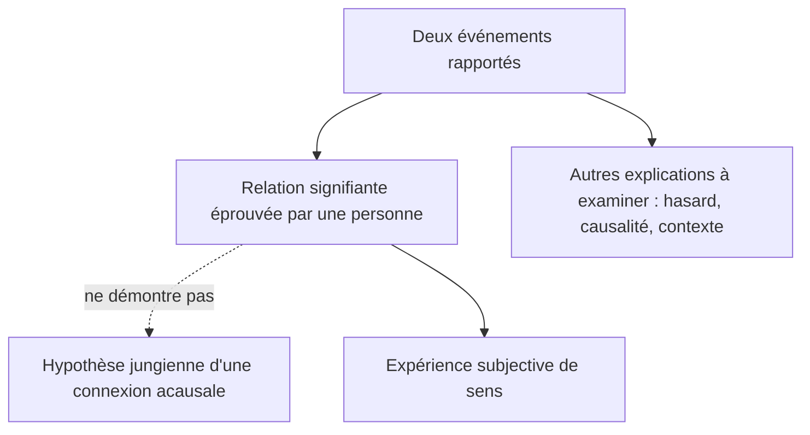

# Jung — Atlas visuel · deuxième série V1

26 novembre 2026 · Atlas 3. Suite des cinq cartes de jung-atlas-visuel-prototype-v1.md. Neuf cartes : six sur les mécanismes et le rêve, trois sur la pensée tardive. Ce sont des synthèses originales des dossiers 01–04, pas une nouvelle collation des sources primaires. Les diagrammes sont des représentations théoriques et pédagogiques, pas des preuves expérimentales ou des protocoles de soin.

## 06 · Constellation d’un complexe

**À retenir.** Une constellation est une hypothèse sur l’organisation de l’expérience, non un diagnostic déduit d’un comportement. L'autonomie du complexe est relative.

Lecture : Dossier 01, IV ; CW 8 §§ 194–205 [J6].

## 07 · Ombre et reconnaissance

**À retenir.** L’ombre n’est pas uniquement négative. Reconnaître une disposition ne commande pas de la réaliser. Une conduite théâtrale n’est pas la preuve d’une ombre personnelle.

Lecture : Dossier 01, VI ; Aïon, chapitre II [J2].

## 08 · Projection : trois plans à ne pas confondre

**À retenir.** Un jugement peut être fondé. La projection n’est ni une explication universelle des désaccords ni une permission d’interpréter autrui contre sa parole.

Lecture : Dossier 01, VI et VIII ; Aïon [J2].

## 09 · Archétype et image archétypique

**À retenir.** L’archétype n’est pas une image héritée toute faite. Le dessin distingue les niveaux d’analyse et ne postule pas une causalité démontrée. Une similitude entre images ne prouve pas l’existence d’une disposition héréditaire.

Lecture : Dossier 01, VII ; dossier 04, XXXI–XXXII ; CW 9/I §§ 87–110, 148–155 [J3, J20].

## 10 · Le rêve et son contexte

**À retenir.** Le schéma illustre un mode d’enquête, pas un décodage. Deux rêves présentant le même motif peuvent recevoir des lectures différentes. Le rêve n’est pas une preuve sur le monde extérieur.

Lecture : Dossier 02, XVIII–XIX ; CW 8 §§ 539–546 [J13].

## 11 · Compensation : plusieurs rapports possibles

**À retenir.** La compensation ne signifie pas systématiquement l’inverse de la vie consciente. Les branches sont une reformulation pédagogique de rapports possibles, non une grille exhaustive ni une loi du rêve.

Lecture : Dossier 02, XVIII ; On the Nature of Dreams, CW 8 §§ 539–546 [J13].

## 12 · Mandala et quaternité : totalité et composition

**À retenir.** Ces lectures ne sont pas équivalentes. Le mandala rituel conserve son contexte propre. Une figure circulaire ne prouve pas une individuation. Les corpus iconographiques seront étudiés dans Atlas 4.

Lecture : Dossier 04, XXXIV–XXXV ; Aïon § 117 [J22] ; Concerning Mandala Symbolism [J23, repérage secondaire].

## 13 · Alchimie : distinguer l’histoire et la lecture psychologique

**À retenir.** Les termes nigredo, albedo, rubedo et parfois citrinitas ne forment pas une progression obligatoire de la psyché. Ce dessin situe les lectures, sans faire de l’alchimie historique une psychologie déguisée.

Lecture : Dossier 04, XXXVI ; CW 12 [J24, passages introductifs] ; CW 14 [J25, repérage].

## 14 · Synchronicité : événement, sens et hypothèse

**À retenir.** Il ne s’agit pas d’une chaîne de preuves. La signification vécue ne prouve ni une connexion acausale ni une destinée. La mécanique quantique ne valide pas cette hypothèse.

Lecture : Dossier 04, XXXVII ; CW 8 §§ 827–828, 849 [J26].

## État de réalisation

Les cartes 06–14 sont prêtes pour la mise en page, mais leur rendu et les renvois cliquables n'ont pas encore été intégrés ou testés dans l'application. Conserver le dossier de Jung et son lexique sans substitution. Les distinctions historiques sur l'alchimie et le mandala sont réservées au dossier symbolique d'Atlas 4 ; les liens futurs ne modifient pas Atlas 1 ni Atlas 2.
